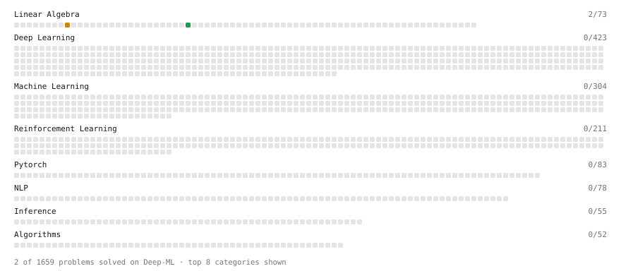

# Deep-ML

My machine learning practice from [Deep-ML](https://www.deep-ml.com). Every solution here was written by hand.

**5** solved · 2 problems · 0 labs · 3 math

[**Browse the interactive portfolio**](https://sarafvaibhav1998.github.io/deep-ml/) to replay this filling in over time.

## Problems

| | Difficulty | Solved | |
| --- | --- | --- | --- |
| [Dot Product Calculator](https://www.deep-ml.com/problems/83) | easy | 2026-10-26 | [solution](problems/0083-dot-product-calculator) |
| [Matrix times Matrix ](https://www.deep-ml.com/problems/9) | medium | 2026-10-26 | [solution](problems/0009-matrix-times-matrix) |

## Math

| | Difficulty | Solved | |
| --- | --- | --- | --- |
| [Inverse and Rank](https://www.deep-ml.com/math-problems/12) | medium | 2026-10-26 | [solution](math/0012-inverse-and-rank) |
| [Solving Linear Systems](https://www.deep-ml.com/math-problems/13) | medium | 2026-10-28 | [solution](math/0013-solving-linear-systems) |
| [Matrix Decompositions: LU and QR](https://www.deep-ml.com/math-problems/15) | hard | 2026-10-28 | [solution](math/0015-matrix-decompositions-lu-and-qr) |

---

_This file is regenerated by Deep-ML on every push._
